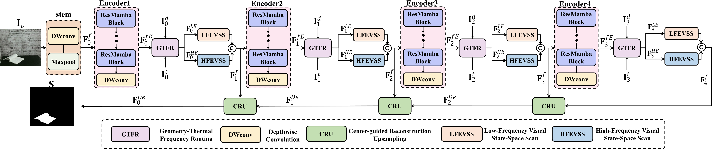

# SDFScan-Mamba

This repository is the official implementation of *SDFScan-Mamba: Lightweight Single-Encoder Dual-Frequency Scan-Aware Mamba Network for V-D-T Salient Object Detection*.

**The source code will be released upon acceptance of the paper.**

## Architecture

  

  <em>Overall architecture of SDFScan-Mamba.</em>

## Results

| Dataset | Sm &uarr; | MAE &darr; | E&xi;mean &uarr; | F&beta;mean &uarr; |
|:--|:--:|:--:|:--:|:--:|
| VDT-2048 | **0.9302** | **0.0026** | **0.9844** | **0.8908** |
| LiTR-2654 | **0.8833** | **0.0430** | **0.9169** | **0.8615** |

SDFScan-Mamba contains only **1.2M parameters** and requires **2.98G FLOPs**.

## Code

The source code, pretrained models, and prediction maps are not publicly available at this stage. They will be released after the paper is accepted.

## Citation

Citation information will be updated after publication.
